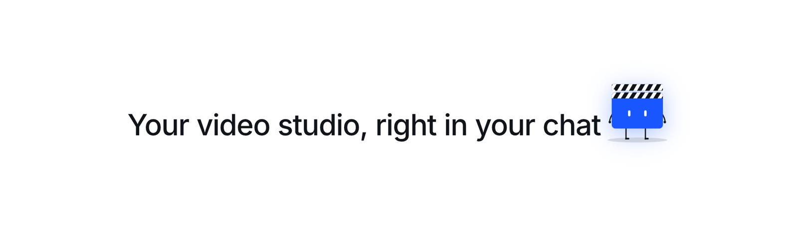

<div align="center">

<a href="https://scenivia.com">
  <picture>
    <source media="(prefers-color-scheme: dark)" srcset="assets/scenivia-wordmark-dark.svg">
    <source media="(prefers-color-scheme: light)" srcset="assets/scenivia-wordmark-light.svg">
    
  </picture>
</a>

### Your product launch film, made from Claude Code

Brief it, pick a template, edit every shot and export the MP4,
without leaving your terminal.

[](#install)
[](#connect-your-account)
[](LICENSE)

<a href="https://cursor.com/en/install-mcp?name=scenivia&config=eyJ1cmwiOiAiaHR0cHM6Ly9hcGkuc2Nlbml2aWEuY29tL21jcCJ9"></a>
<a href="https://insiders.vscode.dev/redirect/mcp/install?name=scenivia&config=%7B%22type%22%3A%22http%22%2C%22url%22%3A%22https%3A%2F%2Fapi.scenivia.com%2Fmcp%22%7D"></a>
<a href="#claude-code"></a>
<a href="#chatgpt"></a>

<br>



<br>

[Install](#install) · [Other apps](#use-it-in-other-apps) · [Connect](#connect-your-account) · [What to ask](#what-to-ask) · [Tools](#tools) · [Limits](#limits-and-credits) · [Support](#support)

</div>

---

## Why

[Scenivia](https://scenivia.com) turns a SaaS product into a short launch or
feature film, built from a catalogue of designed templates you stay in control
of. This plugin gives Claude Code the same controls you have in the Studio.

<table>
  <tr>
    <td width="50%" valign="top">
      <h4>📝 Brief the film</h4>
      Create a project, describe the product, its audience and call to action,
      and set your brand colours and typeface.
    </td>
    <td width="50%" valign="top">
      <h4>🎞️ Pick the right template</h4>
      Compare the Library templates, what each one tells and for which product,
      with a preview, before choosing.
    </td>
  </tr>
  <tr>
    <td width="50%" valign="top">
      <h4>✏️ Edit every shot</h4>
      Retitle a shot, swap a picture, repaint in your colours, change a
      transition. Every batch is checked before it is applied.
    </td>
    <td width="50%" valign="top">
      <h4>📦 Export the MP4</h4>
      Check the export for free, render it in 16:9, 1:1 or 9:16, and get a
      download link.
    </td>
  </tr>
</table>

## Install

Three steps, about a minute.

**1. Add the marketplace and install the plugin** in Claude Code:

```text
/plugin marketplace add Scenivia/claude-plugin
/plugin install scenivia@scenivia
```

**2. Ask for a film.** The first Scenivia call opens the consent page in your
browser: sign in, choose what the agent may do, done.

**3. Watch it come together** in your Scenivia Studio, and export when you like it.

<details>
<summary>From your shell instead</summary>

```bash
claude plugin marketplace add Scenivia/claude-plugin
claude plugin install scenivia@scenivia
```

</details>

The plugin adds one skill and the connection to the Scenivia MCP server at
`https://api.scenivia.com/mcp`. It holds no secret.

## Use it in other apps

The same server works in any app that speaks MCP over HTTP with OAuth. The
address is always `https://api.scenivia.com/mcp`; the consent page opens on
first use, exactly as in Claude Code.

<a id="claude-code"></a>

<details open>
<summary><b>Claude Code</b>, the server alone, without the plugin's skill</summary>

```bash
claude mcp add --transport http scenivia https://api.scenivia.com/mcp
```

</details>

<details>
<summary><b>Cursor</b></summary>

Click **Add to Cursor** above, or add this to `~/.cursor/mcp.json`:

```json
{ "mcpServers": { "scenivia": { "url": "https://api.scenivia.com/mcp" } } }
```

</details>

<details>
<summary><b>VS Code</b></summary>

Click **Install in VS Code** above, or add this to `.vscode/mcp.json`:

```json
{ "servers": { "scenivia": { "type": "http", "url": "https://api.scenivia.com/mcp" } } }
```

</details>

<details>
<summary><b>Claude</b> (claude.ai and the desktop app)</summary>

**Settings › Connectors › Add custom connector**, name it Scenivia and paste
`https://api.scenivia.com/mcp`. Custom connectors depend on your Claude plan.

</details>

<a id="chatgpt"></a>

<details>
<summary><b>ChatGPT</b></summary>

Turn on **developer mode** in **Settings › Apps & Connectors › Advanced**, then
**Create** a connector with the URL `https://api.scenivia.com/mcp` and OAuth.
MCP connectors depend on your ChatGPT plan.

</details>

<details>
<summary><b>Windsurf</b> and other MCP clients</summary>

Add a remote server with the URL `https://api.scenivia.com/mcp`. In Windsurf,
in `~/.codeium/windsurf/mcp_config.json`:

```json
{ "mcpServers": { "scenivia": { "serverUrl": "https://api.scenivia.com/mcp" } } }
```

</details>

## Connect your account

There is nothing to copy or paste: Claude Code opens the Scenivia consent page
and the browser hands the agent its token. Run `/mcp` to see the connection,
reconnect or sign out.

| Scope | Lets the agent |
|---|---|
| `scenivia:read` | read your projects, films, assets and exports |
| `scenivia:edit` | create projects, set briefs and brand, propose and apply edits |
| `scenivia:render` | start exports, which spend credits only when they succeed |

The plugin asks for `read` and `edit`. Exporting needs `render`, which you grant
when Scenivia asks for it on the first export. Disconnect the agent at any time
from **Account › Security**: its token stops working at once.

> [!NOTE]
> Access to the MCP server is opened account by account. Until it is open for
> yours, every call answers `404`.

## What to ask

```text
Make a 30 second launch film for https://example.com in Scenivia.

Which Scenivia templates would suit a developer tool? Show me the previews.

In my "Launch week" project, change the opening title to "Ship docs in minutes".

Repaint the film in our brand colours and use the logo I uploaded.

Check that the film exports cleanly, then render it and give me the link.
```

The agent always asks before it starts an export, since an export spends credits.

## Tools

28 tools, grouped by what they work on.

<details>
<summary><b>Projects and brief</b> · 7 tools</summary>

| Tool | What it does | Scope |
|---|---|---|
| `list_projects` | Lists the projects you can open, most recent first | read |
| `get_project` | Reads a project: brief, revision, shots, length, format, template | read |
| `create_project` | Creates an empty project | edit |
| `set_brief` | Sets the product, audience, goal, call to action and length | edit |
| `get_brand` | Reads the brand colours, typeface and logo | read |
| `set_brand_style` | Sets the brand colours and typeface | edit |
| `start_storyboard_job` · `get_storyboard_job` | Writes a film from a prompt, the brief and your screenshots, and reads its progress | edit · read |

</details>

<details>
<summary><b>Templates, components and assets</b> · 9 tools</summary>

| Tool | What it does | Scope |
|---|---|---|
| `list_templates` | Lists the Library templates, what each tells and for which product | read |
| `inspect_template` | Details one template: its shots, lines, pictures and limits | read |
| `find_components` | Searches the components a new shot can be made from | read |
| `preview_component` | Shows the preview image of one component | read |
| `list_transitions` | Lists the transitions between shots and their lengths | read |
| `list_backgrounds` | Lists the backgrounds a shot can take | read |
| `list_assets` | Lists the pictures, clips, tracks and fonts of a project | read |
| `add_asset_from_url` | Adds a public PNG, JPEG or WebP image to a project | edit |
| `find_layers` · `inspect_layer` | Finds layers by shot, word or component, and reads their controls | read |

</details>

<details>
<summary><b>Edits</b> · 4 tools</summary>

| Tool | What it does | Scope |
|---|---|---|
| `propose_edits` | Checks a batch of edits and returns a turn to apply, saves nothing | edit |
| `propose_structure` | Checks adding a shot at the end or removing one, saves nothing | edit |
| `apply_turn` | Applies a proposed turn, once | edit |
| `get_turn` | Reads whether a turn was applied, and at which revision | read |

</details>

<details>
<summary><b>Export</b> · 6 tools</summary>

| Tool | What it does | Scope |
|---|---|---|
| `check_export` | Says whether the film exports and what it would lose, for free | read |
| `start_render` | Renders the film to MP4 | render |
| `get_render` · `list_renders` | Reads the status of one export, or lists a project's exports | read |
| `get_render_download` | Returns a download link, valid five minutes | read |
| `retry_render` | Renders a failed export again | render |

</details>

Arguments, outputs and JSON Schemas:
[`capabilities.md`](plugins/scenivia/skills/scenivia/references/capabilities.md) ·
[`catalog.json`](plugins/scenivia/skills/scenivia/references/catalog.json)

## Limits and credits

> [!TIP]
> **Nothing is charged until an export succeeds.** A failed export costs
> nothing, and a retry costs credits only if it succeeds.

- Credits are bought in Scenivia, never through the agent. Out of credits, the agent says so and stops.
- Writing a storyboard from a prompt uses your plan's generation allowance, not credits.
- Three exports run at once per account; a fourth waits for one to end.
- 120 tool calls a minute per account; template and component browsing, 60 calls an hour.
- Pictures come in from a public HTTPS address (PNG, JPEG or WebP), with the same checks as an upload.
- Placing a template, or adding and removing a shot, lands in your Studio: the agent prepares it, you see it when you open the project.

Every bound: [`limits.md`](plugins/scenivia/skills/scenivia/references/limits.md)

<details>
<summary><b>When something goes wrong</b></summary>

| What you see | What to do |
|---|---|
| `401` on every call | The connection expired or was revoked. Run `/mcp` and reconnect. |
| `insufficient_scope` | The tool needs a scope you did not grant, often `scenivia:render`. |
| `stale_revision` | The film changed since it was read, often in the Studio. The agent reads it again. |
| `awaiting_studio` | Not an error: open the project in the Studio and the change lands there. |
| `requires_open_studio` | The change was prepared in the Studio chat; apply it in the Studio. |
| `insufficient_credits` | Buy credits in Scenivia, then ask again. |

Every code: [`errors.md`](plugins/scenivia/skills/scenivia/references/errors.md)

</details>

## Support

Questions, a bug, an idea: **[support@scenivia.com](mailto:support@scenivia.com)** · [scenivia.com](https://scenivia.com)

## License

Free to install and use with Scenivia, commercial work included. See [LICENSE](LICENSE).
